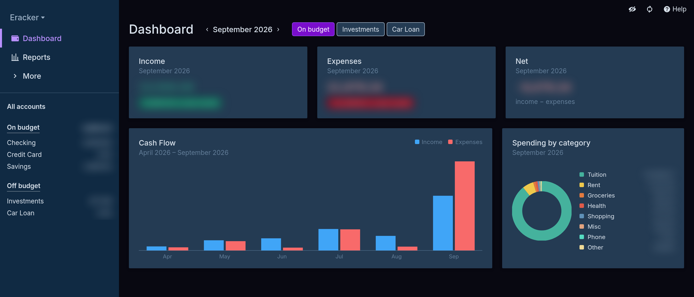

# Eracker

A fast, read-only dashboard for your [Actual Budget](https://github.com/actualbudget/actual) data.
It answers the questions Actual's budget screen doesn't make obvious: how much did I earn this
month, how much did I spend, did I gain or lose money, and where did it go?



## Features

- **Dashboard**: income, expenses and net for any month, change from last month, 6-month cash
  flow, and spending by category
- **Reports**: balance trend, 12-month cash flow and a monthly summary table
- **On budget / off budget**: separate views, like Actual's account groups. Off-budget accounts
  are shown one at a time and never added together; switch to *Combined* in Settings to group them
- **Accounts**: every transaction with search, category filter, sorting, running balance and
  selection totals
- **Privacy filter** (`Ctrl/⌘+Shift+P`) blurs every amount, as in the screenshot
- **Keyboard shortcuts** (`?`) and a command palette (`Ctrl/⌘+K`)
- Dark, light and midnight themes, CSV export

Eracker never writes to your budget; Actual stays the source of truth.

## How it works

Eracker runs next to your Actual server. It reads the budget through the official
[`@actual-app/api`](https://actualbudget.org/docs/api/), syncs at most once a minute, and serves
the web app plus a JSON snapshot of your accounts, categories and transactions.

Totals are counted like this:

- Income is money in an income category; everything else is spending, and refunds reduce it.
- Transfers between accounts in the same view are neither income nor spending.
- Off-budget accounts have no categories, so their spending is broken down by payee.

## Setup

Requires Node.js 22+ and a running [Actual sync server](https://actualbudget.org/docs/install/).

```bash
git clone <this repository> eracker
cd eracker
npm install
cp .env.example .env
npm run build
npm start
```

| `.env` | |
|---|---|
| `ACTUAL_SERVER_URL` | your Actual server, e.g. `http://127.0.0.1:5006` |
| `ACTUAL_PASSWORD` | your Actual server password |
| `ACTUAL_SYNC_ID` | in Actual: Settings → Show advanced settings → Sync ID |
| `ERACKER_HOST` | listen address, default `127.0.0.1` |
| `ERACKER_PORT` | listen port, default `5007` |

Eracker has no login. Keep it on `127.0.0.1` or a private network (LAN, VPN, Tailscale), never
on the public internet.

### Run it as a service

```bash
cp server/eracker.service ~/.config/systemd/user/   # adjust paths if not cloned to ~/eracker
systemctl --user enable --now eracker
```

### Update

```bash
git pull && npm install && npm run build
systemctl --user restart eracker
```

Keep `@actual-app/api` in `package.json` on the same version as your Actual server.

## Development

```bash
npm run dev
```

Serves the app on port 5173 and proxies `/api` to `http://localhost:5007`; set `ERACKER_API` to
use another Eracker server.

## Credits

Built on [Actual Budget](https://github.com/actualbudget/actual). Colors and icons are derived
from Actual (MIT); see [THIRD_PARTY_NOTICES.md](./THIRD_PARTY_NOTICES.md).
